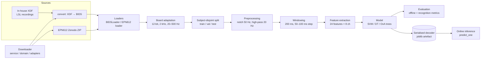

# Design Solution Definition: EMG Decoding Pipeline

> **Project:** EMG Decoder V2
> **Document ID:** `DSD-001-EMG-DECODING`
> **Version:** `0.1.0` · **Status:** `Draft`
> **Project phase:** `Proof of Concept`
> **Last modified:** `2026-10-18`
> **Repository path:** `docs/SDR.md`

---

## Document control

### Roles and sign-off

| Role | Name | Affiliation / Handle | Date | Signature / Review link |
|---|---|---|---|---|
| Author(s) | Guilherme Costa-Ferreira| TL / `GuilhermeCF`| | |
| Author(s) | David Gorgiev| EMG Member / `dgorgiev`| | |
| Author(s) | Luca Tellegen| EMG Member / `lucawltepfl`| | |
| Reviewer (technical) | `<TBD>` | | | |
| Concurrence (SE Reviewer) | `<TBD>` | | | |
| Concurrence (Quality management reviewer) | `<TBD>` | | | |
| Approval (Project Manager) | `<TBD>` | | | |

> Note : Link approval to any relevant PR (Pull Request)
> Affiliation/Handle : Role/ Username on Github

### Modification log

| Version | Date | Author(s) | Main changes | PR / Commit |
|---|---|---|---|---|
| 0.1.0 | 2026-10-18 | Guilherme Costa-Ferreira | First draft filled from repository state (`docs/sdr` branch) | `cd7b1a3` |

---

## Table of contents

1. [Introduction](#1-introduction)
2. [Requirements and traceability](#2-requirements-and-traceability)
3. [Concept justification](#3-concept-justification)
4. [Traded-off concepts](#4-traded-off-concepts)
5. [Quality management and compliance](#5-quality-management-and-compliance) /!\ THIS SECTION IS NOT FINALISED /!\
6. [Licensing](#6-licensing) /!\ THIS SECTION IS NOT FINALISED /!\
7. [Open issues and future work](#7-open-issues-and-future-work)
8. [References](#8-references)
9. [Appendices](#9-appendices)

---

## 1. Introduction

### 1.1 Purpose and scope

This Design Solution Definition (DSD) is at a `Proof of concept` stage
validated on `<date>`. It justifies the concept selected for the `EMG decoding pipeline V2`.

It covers:

- the problem the subsystem must solve
- the retained concept: architecture, components, and design choices
- the concepts that were considered and not retained
- risks, quality, and compliance implications.

**Out of scope:**
- EMG acquisition hardware (analog front-end, electrodes, ADC board) - covered by the BMI hardware team.
- Embedded firmware and on-MCU deployment - assessed separately in [`docs/adapt_to_board.md`](adapt_to_board.md) and on the [Firmware Repository](https://github.com/N-Pulse/BMI-EMG-Firmware/tree/i2c_adc)
- EEG decoding and prosthesis actuation/control - also on their own [EEG Repository](https://github.com/N-Pulse/BMI-SOFT-EEG-Decoding)
- Previous decoding models and research

### 1.2 Responsibility and change authority

- **Document owner:** Guilherme Costa-Ferreira, Decoding Team
- **Change authority:** Decoding TL (repository maintainer). Changes are proposed through meetings and then merged through a reviewed pull request into `main`, following `.github/pull_request_template.md`.

### 1.3 Abbreviated terms and definitions

| Term | Definition |
|---|---|
| DSD | Design Solution Definition |
| EMG / sEMG | (Surface) electromyography |
| EPN612 | EMG-EPN-612 public dataset (Myo armband, 8 ch, 200 Hz, 612 users, 6 gestures) |
| BIDS | Brain Imaging Data Structure, used for the in-house archive |
| XDF | Extensible Data Format (LSL recordings from the in-house acquisition) |
| DoF | Degree of freedom of the hand/wrist |
| MAV, RMS, WL, ZC, SSC… | Time-domain EMG features (mean absolute value, root mean square, waveform length, zero crossings, slope sign changes) |
| SVM | Support Vector Machine (linear, `LinearSVC`) |
| DT / RF | Decision tree / Random forest |
| CNN | Convolutional neural network |
| OvA | One-versus-all classification |
| MCU | Microcontroller unit (target: STM32WBA65RI) |

## 2. Requirements and traceability

| Requirement ID | Description (derived) | Verification method | Status |
|---|---|---|---|
| REQ-SW-001 | The pipeline shall ingest in-house recordings (XDF → BIDS) and the EPN612 public dataset through a single download/load interface. | D | met (downloader subpackage) |
| REQ-SW-002 | The decoder shall classify the gesture set {noGesture, fist, rotate wriste right, rotate wriste left, open, pinch}. | T | not met |
| REQ-SW-003 | The decoder should be tested on windows of 25-200 ms | T | not met |
| REQ-SW-004 | The model + preprocessing shall fit the STM32WBA65RI (2 MB Flash, 512 KB SRAM, 100 MHz Cortex-M33). | A | not met |
| REQ-SW-005 | The integrated model should infere in less than 200 ms | T | not met |
| REQ-SW-006 | Evaluation shall be subject-disjoint (train/val/test split by participant). | I, T | met at prune subpackage |
| REQ-SW-007 | Training data shall be adapted to the deployment acquisition domain (12-bit ADC, 2000 Hz, 20–500 Hz band). | T | partial at prune subpackage|
| REQ-SW-008 | Online recognition shall report classification metrics, robustness metrics and time metrics. | T | partial met offline (`scripts/evaluation/`) |
| REQ-SW-009 | Experiments shall be reproducible from config files with fixed seeds. | I | partial |
| REQ-SW-010 | Only reviewd and refactored code should live in the subpackages, the rest shall live at scripts | D | partial |
| REQ-SW-011 | The model should outperform in classification and robustness metrics the V1 model | D | not met |

> **Verification methods:** (D)emonstration, (T)est, (M)easurement, (I)nspection, (A)nalysis

---

## 3. Concept justification

The design aims at a decoder that is (1) accurate enough on a small gesture set, (2) cheap enough to run on an low compute chip, and (3) trainable today on public data while the in-house dataset grows. Every element below follows from those three constraints.

### 3.1 Solution overview

The main concept for the V2 is 

The retained concept is a **classical, windowed feature-based pipeline**: raw EMG is filtered, cut into 200 ms windows, reduced to a fixed vector of time-domain (plus a few spectral) features per channel, standardised, and classified by a lightweight scikit-learn model (linear SVM by default, decision trees for channel/feature importance and MCU-friendly inference). Data comes either from the public EPN612 dataset - adapted to the target board's ADC domain - or from the in-house XDF/BIDS archive, through a layered, registry-based downloader and `mne`-based loaders.

*Figure 3.1: High-level architecture of the EMG decoding pipeline.*

### 3.2 Main design choices

#### 3.2.1 Feature-based classical ML over end-to-end deep learning

- **Decision:** Hand-crafted per-channel features (`preprocessing/features`, 24 types) fed to scikit-learn models via `ModelFactory` subclasses (`SVMFactory`, `DecisionTreeFactory`, `LogisticRegressionFactory`).
- **Rationale:** Time-domain features are O(n) and dominate the embedded compute budget; literature (Paper 1 in `adapt_to_board.md`) shows >94 % accuracy with such features on an 8-ch / 6-gesture setup. Small models train in seconds and are directly portable to C (micromlgen / emlearn).
- **Requirements addressed:** REQ-SW-002, REQ-SW-004, REQ-SW-005
- **Consequences / limitations:** Performance is bounded by feature quality; cross-subject generalisation may be lower than deep models. A CNN (`scripts/cnn/`) is kept as a benchmark (see §4).

#### 3.2.2 Linear SVM as the default decoder, trees for importance and pruning

- **Decision:** `EMGSVMDecoder` (StandardScaler + `LinearSVC`, `class_weight="balanced"`) is the reference decoder; decision trees (one gesture-vs-all tree per gesture) are used to rank channels and features and to evaluate Top-4/Top-6 channel subsets.
- **Rationale:** Linear SVM is a small weight matrix (classes × features), trivially exported to an MCU; trees give interpretable importances used to cut channel count and feature cost.
- **Requirements addressed:** REQ-SW-002, REQ-SW-005, REQ-SW-008
- **Consequences / limitations:** Channel ranking in `epn612_final` is learned on both labelled fields, so pruning scores are descriptive, not an independent test (see OI-04).

#### 3.2.3 Board-domain adaptation of public data

- **Decision:** EPN612 (8-bit, 200 Hz Myo) is lazily converted to the deployment domain (centred signed 12-bit, 2000 Hz via `resample_poly`, 1st-order 20–500 Hz band-pass).
- **Rationale:** Allows training now on 612 users while the target board's own recordings are scarce, and makes features numerically comparable to the board.
- **Requirements addressed:** REQ-SW-007
- **Consequences / limitations:** No information above the 100 Hz source Nyquist can be recovered; the adaptation does not recover physical volts. Real board data is still needed for validation.

#### 3.2.4 Subject-disjoint, movement-balanced splits

- **Decision:** Train/val/test splits are made by participant and balanced per movement (`data/epn612/split.py`).
- **Rationale:** A prosthesis must generalise to its wearer; within-subject splits overestimate accuracy.
- **Requirements addressed:** REQ-SW-006
- **Consequences / limitations:** Lower reported scores than window-level random splits; per-user calibration may be needed later.

#### 3.2.5 Layered, registry-based data acquisition

- **Decision:** `src/bmiemg/download` split into `service` (Downloader), I/O-free `domain` (specs, strategies, registry) and per-source `adapters` (archive, EPN612). In-house data is converted XDF → BIDS and read with `mne-bids`.
- **Rationale:** New sources are added by writing an adapter only; BIDS gives a standard, tool-supported layout.
- **Requirements addressed:** REQ-SW-001
- **Consequences / limitations:** Extra abstraction for few sources today.

#### 3.2.6 Shared train/inference artefact

- **Decision:** One dataclass (`EMGSVMDecoder`) holds the processing config, fitted scaler and model, and offers `fit`, `predict` and a streaming `predict_one`; saved with joblib.
- **Rationale:** Prevents train/serve skew in feature extraction.
- **Requirements addressed:** REQ-SW-008
- **Consequences / limitations:** Python-only artefact; MCU export is a separate step.

#### 3.2.7 Operating modes

| Mode / Stage | Purpose | Entry condition | Exit condition | Active components |
|---|---|---|---|---|
| Data acquisition | Fetch and convert raw data | `DownloadSpecs` built and `Downloader.run()` called | Raw data under `data/raw/` validated | Downloader, adapters, XDF→BIDS converter |
| Offline training | Fit decoder on a split | Config (`configs/*.yml`) and data available | Model, metrics, confusion matrix saved under `results/` | Loaders, adaptation, preprocessing, features, `Trainer`, model factories |
| Analysis / pruning | Rank channels and features, sweep subsets | Cached feature run directory exists | Importance CSVs and figures produced | `scripts/epn612_final/*`, `postprocessing/importance_pruning.py` |
| Offline recognition evaluation | Replay recordings as a stream and score | Trained model + labelled XDF | Report (accuracy, flips/s, ρ) | `scripts/evaluation/recog_eval_*` |
| Online inference | Predict per incoming window | Loaded decoder, buffer filled with one window | Stream stops | `EMGSVMDecoder.predict_one` |
| Safe / fault state | Reject bad inputs | Wrong window shape, sampling rate or < 2 classes | Exception raised to caller | Validation in decoder and loaders |

### 3.3 Functionally linked systems

- **BMI acquisition hardware / STM32WBA65RI board** - source of live EMG; defines ADC resolution, sampling rate and analog band (20–500 Hz).
- **Embedded firmware** - will host the exported model (`docs/adapt_to_board.md`).
- **LSL / XDF recording setup** and the in-house **BIDS archive** - source of labelled in-house sessions (triggers mapped to codes via `data/epoch/TriggerMap.py`).
- **EMG-EPN-612 dataset (Zenodo)** - public training data.
- **Prosthetic arm controller** - downstream consumer of gesture labels (planned).
- **EEG decoding** - planned parallel modality, not covered here.

### 3.4 Performance budgets and design margins

| Budget | Target | Current estimate / value | Source |
|---|---|---|---|
| End-to-end latency | < 200 ms | 200 ms window + ~20–25 ms features + ~5–10 ms inference on 100 MHz M33 | `adapt_to_board.md` §4.3 (analysis) |
| Flash | ≤ 2048 KB | RF(100 trees) ~530 KB; linear SVM ≪ 100 KB (6 × 192 weights) | `adapt_to_board.md` §4.1 |
| SRAM | ≤ 512 KB | Window buffer 8 ch × 400 samples (2 kHz) ≈ 6.4 KB at int16 | derived |
| Input dimensionality | minimise | 24 features × 8 ch = 192; Top-4/Top-6 channel subsets evaluated | `scripts/epn612_final` |
| Compute | real-time at 100 MHz | Prefer O(n) time-domain features; spectral features (FFT) to be pruned | `adapt_to_board.md` |

> Margins are analytical only; on-device measurement is pending (OI-03).

---

## 4. Traded-off concepts

### 4.1 Trade-off method

The trade-off method used was based on the following criteria :
- Meets performance requirements (accuracy on subject-disjoint gesture classification)
- Embedded feasibility (memory, compute, latency on STM32WBA65RI)
- Data efficiency (works with limited in-house labelled data)
- Interpretability and debuggability
- Development effort and tooling maturity
- Maintainability and community support

Weights reflect a proof of concept that must ultimately run on an MCU.

| Criterion | Weight (1 - 5) | Rationale for weight |
|---|---|---|
| Meets performance requirements | 5 | The decoder must reliably separate the 6 gestures across subjects. |
| Embedded feasibility | 5 | Final target is a 100 MHz MCU with no accelerator; a model that cannot be deployed is a dead end. |
| Data efficiency | 4 | In-house labelled data is scarce; public data is from a different device. |
| Interpretability | 3 | Needed to choose channels/features and to debug acquisition issues. |
| Development effort | 3 | Student team with limited time per semester. |
| Maintainability and community support | 2 | Useful for handover between cohorts, not critical at PoC stage. |

Score scale :
> [1] : Does not meet any requirements
> [2] : Meets some requirements
> [3] : Meets all minimum requirements 'Shall' requirements
> [4] : Meets all minimum requirements and 'should'
> [5] : Meets all requirements, 'Shall, should & may'

> Scores below are the author's qualitative assessment at PoC stage; quantitative comparison on the same split is pending (OI-05). Max score = 5 × (5+5+4+3+3+2) = 110.

### 4.2 Traded-off design choices

#### 4.2.1 Alternative A - End-to-end CNN on raw windows

- **Description:** Five-block CNN (Atzori et al. 2016) treating each window as a (time × electrodes) image (`scripts/cnn/cnn.py`, `train.py`).
- **Pros:** Learns features automatically; strong results in literature with enough data; no feature engineering.
- **Cons:** Needs large labelled datasets; heavier compute/memory, requires STM32Cube.AI and quantisation; harder to interpret; PyTorch dependency outside the main package.

| Criterion | Weight (1-5) | score (1-5) |
|---|---|---|
| Meets performance requirements | 5 | 4 |
| Embedded feasibility | 5 | 2 |
| Data efficiency | 4 | 2 |
| Interpretability | 3 | 1 |
| Development effort | 3 | 3 |
| Maintainability and community support | 2 | 4 |
| ---|---|---|
|Total Score| 65 | max score : 110 |

#### 4.2.2 Alternative B - Random Forest (100 trees)

- **Description:** Ensemble of decision trees on the same features (previous default in `configs/train.yml`, recommended in `adapt_to_board.md`).
- **Pros:** Non-linear, robust, built-in importances, proven MCU ports (micromlgen).
- **Cons:** ~530 KB Flash; inference cost grows with trees; larger artefact than linear model.

| Criterion | Weight (1-5) | score (1-5) |
|---|---|---|
| Meets performance requirements | 5 | 4 |
| Embedded feasibility | 5 | 4 |
| Data efficiency | 4 | 4 |
| Interpretability | 3 | 3 |
| Development effort | 3 | 4 |
| Maintainability and community support | 2 | 4 |
| ---|---|---|
|Total Score| 83 | max score : 110 |

#### 4.2.3 Alternative C - Per-DoF regression / classification (8 DoF models)

- **Description:** One model per degree of freedom (wrist flex/ext, pro/sup, thumb, fingers) as in `configs/train.yml` `dof_list`.
- **Pros:** Enables proportional, multi-DoF control.
- **Cons:** Needs DoF-level labels not yet produced by the label pipeline (TODO in config); 8× the models; no public dataset with matching labels.

| Criterion | Weight (1-5) | score (1-5) |
|---|---|---|
| Meets performance requirements | 5 | 2 |
| Embedded feasibility | 5 | 3 |
| Data efficiency | 4 | 1 |
| Interpretability | 3 | 3 |
| Development effort | 3 | 2 |
| Maintainability and community support | 2 | 3 |
| ---|---|---|
|Total Score| 50 | max score : 110 |

#### 4.2.4 Retained - Feature-based linear SVM (+ OvA trees for channel/feature selection)

- **Pros:** Smallest model footprint; fast to train and evaluate; shared artefact for online use; trees give channel/feature pruning to cut compute.
- **Cons:** Linear boundary may limit accuracy on hard gestures (waveIn/waveOut); still relies on 192 features before pruning.

| Criterion | Weight (1-5) | score (1-5) |
|---|---|---|
| Meets performance requirements | 5 | 3 |
| Embedded feasibility | 5 | 5 |
| Data efficiency | 4 | 4 |
| Interpretability | 3 | 4 |
| Development effort | 3 | 4 |
| Maintainability and community support | 2 | 4 |
| ---|---|---|
|Total Score| 87 | max score : 110 |

### 4.3 Trade-off summary

| Option | Score | Retained | Key reason |
|---|---|---|---|
| Feature-based linear SVM + OvA trees | 87 | Yes | Best embedded fit, interpretable, data-efficient |
| Random Forest (100 trees) | 83 | Fallback | Similar accuracy, larger footprint; kept as first upgrade path |
| End-to-end CNN | 65 | No (benchmark) | Data-hungry and costly on MCU |
| Per-DoF models | 50 | No (future) | Labels not available yet |

## 5. Quality management and compliance

**WORK IN PROGRESS**

Current status: research-use only (RUO) proof of concept; no clinical use. Good-practice measures in place: pytest suite (`tests/`), pre-commit, black/pylint, PR and issue templates, reviewed merges into `main`.

<!--
### 5.1 Regulatory classification and pathway

| Item | Statement |
|---|---|
| Intended use classification | `<RUO / IVD / medical device / bioprocess / environmental / other>` |
| Target jurisdictions | `<EU / US / CH / UK / other>` |
| Applicable regulation | `<e.g. EU IVDR 2017/746, EU MDR 2017/745, FDA 21 CFR 820 (QMSR), 21 CFR Part 11>` |
| Device / product class | `<class and rationale>` |
| Regulatory strategy | `<summary, notified body / agency contact status>` |

### 5.2 Quality management system

- **QMS framework:** `<ISO 13485 / ISO 9001 / GLP / GMP / GCP / lightweight in-house QMS>`
- **QMS scope and document hierarchy:** `<link>`
- **Design controls followed:** `<design inputs → outputs → review → verification → validation → transfer → changes>`
- **This document's place in the design history file (DHF):** `<link>`

### 5.3 Applicable standards and guidelines

| Standard / Guideline | Title | Applicability | Compliance status |
|---|---|---|---|
| ISO 13485 | Medical devices: Quality management systems | | Planned / Partial / Compliant / N/A |
| ISO 14971 | Application of risk management to medical devices | | |
| IEC 62304 | Medical device software life cycle | | |
| IEC 61010-1 | Safety of electrical equipment for measurement, control, laboratory use | | |
| IEC 62366-1 | Usability engineering | | |
| ISO 20387 | Biobanking: general requirements | | |
| `<other>` | | | |

### 5.4 Ethics, access, and biosecurity compliance

| Topic | Applicability | Status / reference |
|---|---|---|
| Ethics committee / IRB approval | | |
| Informed consent | | |
| Nagoya Protocol / access and benefit sharing | | |
| Biosafety committee approval | | |
| Import / export / dual-use controls | | |
| Animal research regulations | | |

-->

## 6. Licensing

**WORK IN PROGRESS**

<!--
| Topic | Decision |
|---|---|
| Hardware license | `<CERN-OHL-S / CERN-OHL-W / TAPR / other>` |
| Software license | `<Apache-2.0 / GPL-3.0 / MIT / other>` |
| Documentation and data license | `<CC-BY-4.0 / CC0 / other>` |
| Open Source Hardware certification | `<OSHWA status>` |
| Licence compatibility of all dependencies | `<checked on YYYY-MM-DD, link to SBOM>` |
| Patents / IP / prior art | `<statement, defensive publication?>` |
| Contribution and governance model | `<link to CONTRIBUTING.md / GOVERNANCE.md>` |
| Liability and warranty disclaimer | `<statement, especially for any clinical use>` |
| Sourcing for builders | `<BOM with alternates, availability of parts worldwide>` |
| Quality of community-contributed changes | `<review gates, required tests, who can merge>` |

-->

## 7. Open issues and future work

| ID | Issue / TBD / TBC | Owner | Due | Impact if unresolved |
|---|---|---|---|---|
| OI-01 | No formal requirements document; REQ IDs in §2 are derived and must be confirmed | BMI-SOFT lead | TBD | Traceability cannot be signed off |
| OI-02 | Validate the decoder on real recordings from the target board (domain gap vs adapted EPN612) | BMI-SOFT / HW | TBD | Reported accuracy may not transfer to the device |
| OI-03 | Export model to C and measure latency, Flash and RAM on STM32WBA65RI | Embedded team | TBD | REQ-SW-004/005 remain analysis-only |
| OI-04 | Channel/feature ranking uses both labelled fields; redo selection on train only and test on held-out users | BMI-SOFT | TBD | Optimistic pruning results |
| OI-05 | Benchmark SVM, RF and CNN on the same subject-disjoint split and update §4 scores | BMI-SOFT | TBD | Trade-off scores remain qualitative |
| OI-06 | Produce DoF-level labels for in-house data (`configs/train.yml` TODO) | BMI-SOFT | TBD | Multi-DoF control blocked |
| OI-07 | Declare pandas/joblib/torch as direct dependencies; fix `pyproject.toml` author placeholder | BMI-SOFT | TBD | Fragile environment setup |
| OI-08 | Two preprocessing modules coexist (`libML/preprocessing.py`, `preprocessing_new.py`) with `src/bmiemg/preprocessing` | BMI-SOFT | TBD | Divergent feature definitions |
| OI-09 | Choose software/data licence and fill §5–§6 | Project management | TBD | Cannot publish or share openly |

---

## 8. References

1. Applicable documents: project requirements specification `<TBD>`; [`docs/adapt_to_board.md`](adapt_to_board.md); [`docs/diagrams/class.puml`](diagrams/class.puml), [`docs/diagrams/activity.puml`](diagrams/activity.puml); [`scripts/epn612_final/README.md`](../scripts/epn612_final/README.md); [`src/bmiemg/download/README.md`](../src/bmiemg/download/README.md).
2. Reference documents:
   - Benalcázar M. et al., *EMG-EPN-612 dataset*, Zenodo.
   - Atzori M. et al. (2016), *Deep learning with convolutional neural networks applied to electromyography data*, Frontiers in Neurorobotics.
   - *On the Deployment of Edge AI Models for Surface Electromyography-Based Hand Gesture Recognition* (Paper 1 in `adapt_to_board.md`).
   - *Microcontroller Implementation of LSTM Neural Networks for Dynamic Hand Gesture Recognition* (Paper 2 in `adapt_to_board.md`).
   - STMicroelectronics, NUCLEO-WBA65RI / STM32WBA65RI datasheet.
   - BIDS specification; `mne` / `mne-bids` documentation.

---

## 9. Appendices

### Appendix A: Bill of materials

Software-only subsystem: no hardware BOM. Software dependencies are pinned in [`pyproject.toml`](../pyproject.toml) and [`poetry.lock`](../poetry.lock) (Python 3.12; numpy, scipy, scikit-learn, polars, mne, mne-bids, pyxdf, hydra-core, matplotlib/seaborn; dev: black, pylint, pytest, pre-commit).

### Appendix B: Repository map

| Path | Role |
|---|---|
| `src/bmiemg/download/` | Layered downloader (service / domain / adapters) |
| `src/bmiemg/data/` | XDF→BIDS conversion, epoching, BIDS and EPN612 loaders, adaptation, splits |
| `src/bmiemg/preprocessing/` | Filters, segmentation, envelope, feature extraction |
| `src/bmiemg/models/` | Model factories, target builders, trainer, evaluator, registry |
| `src/bmiemg/pipeline/emg_decoder.py` | Shared training / online-inference artefact |
| `src/bmiemg/postprocessing/` | Importance-based pruning |
| `scripts/epn612_final/` | Final EPN612 importance and channel-pruning experiment |
| `scripts/evaluation/` | Offline recognition evaluation (accuracy, flips/s, ρ) |
| `scripts/cnn/` | CNN benchmark |
| `configs/` | Training / evaluation configurations |
| `tests/` | pytest suite for EPN612 loader, adaptation, preprocessing, training, decoder |
