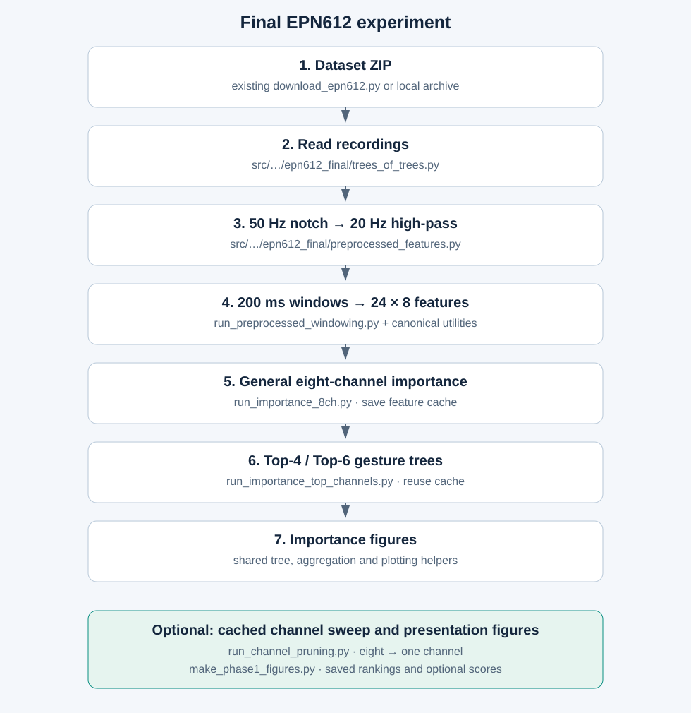

# Final EPN612 experiment

The PR code is collected in `scripts/epn612_final/` and
`src/bmiemg/data/epn612_final/`. Original experiment scripts and generated
results remain at their original locations as local records; they are not
needed by these new folders.

## Run in order

From the repository root, install the existing Python 3.12 Poetry environment:

```sh
poetry install
```

Place `EMG-EPN612 Dataset.zip` under `data/raw/emg_epn_612/`, or run the
existing tracked downloader (no downloader changes are needed for this PR):

```sh
poetry run python scripts/download/download_epn612.py
```

Run the final extraction and general importance analysis:

```sh
poetry run python -B scripts/epn612_final/run_importance_8ch.py
```

It prints a new output directory. Pass that exact directory as `RUN_DIRECTORY`
in the commands below. `--output PATH` can set an explicit new directory.
For a short real-data check, use `--validate-only` with a separate output path;
validation-only output cannot be used as a full feature cache.

```sh
poetry run python -B scripts/epn612_final/run_importance_top_channels.py --source RUN_DIRECTORY
```

This second command reuses extracted features; it does not repeat filtering.
It fits six gesture-versus-all trees for Top-4 and Top-6, saving the models,
importance CSVs, and per-gesture/global plots. `--n-jobs 1` limits concurrent fits.

Optional: evaluate all nested channel subsets, from eight down to one, on
those same cached high-pass windows, and draw presentation figures:

```sh
poetry run python -B scripts/epn612_final/run_channel_pruning.py --source RUN_DIRECTORY
poetry run python -B scripts/epn612_final/make_phase1_figures.py --source RUN_DIRECTORY
```

The channel sweep can resume saved individual trees. `--plot-only` redraws
its saved scores. Its models live separately from the importance-only models
under `RUN_DIRECTORY/channel_pruning/topN/`.
Presentation figures always include channel/feature rankings; confusion and
performance summaries are added when the optional eight-channel evaluation exists.

## Pipeline



1. Read each user JSON from the ZIP, preserving its original training/testing fields.
2. Filter each **full recording**: 50 Hz notch (Q=30), then fourth-order
   20 Hz high-pass, at 200 Hz. Both use zero-phase `filtfilt`.
3. Create 200 ms windows, 100 ms step, 50% overlap. Keep gesture windows
   wholly inside supplied annotations and complete windows from rest recordings.
4. Extract all 24 canonical feature types across eight channels: 192 inputs.
5. Fit the descriptive general importance tree on both labeled fields.
6. Rank channels; fit Top-4/Top-6 binary trees using training windows only.

The original final run selected `ch4, ch1, ch8, ch7`, adding `ch3, ch2` for
Top-6. Ranking is learned from both labeled fields, so optional sweep scores
are descriptive comparisons on the existing split, not an independent test
of channel selection. The original final importance experiment reports no
held-out accuracy. The optional sweep is a separate analysis.

## Exact PR files

```text
scripts/epn612_final/
├── .gitignore
├── README.md
├── pipeline.svg
├── __init__.py
├── run_importance_8ch.py                 # launch: filter/extract/general importance
├── run_importance_top_channels.py       # launch: cached Top-4/Top-6 importance
├── run_channel_pruning.py               # optional: cached 8→1 evaluation
├── make_phase1_figures.py               # launch: presentation figures
├── run_preprocessed_windowing.py        # shared extraction/windowing helpers
├── run_trees_of_trees.py                # shared tree/importance helpers
├── train_custom_trees_of_trees.py        # shared feature-type aggregation
└── make_phase2a_feature_figures.py       # shared importance plotting

src/bmiemg/data/epn612_final/
├── __init__.py
├── trees_of_trees.py                    # dataset reader, label/feature naming
└── preprocessed_features.py             # checks + final high-pass/notch filter
```

The historical helper filenames are retained for traceability. Their contents
in this folder are scoped to the final pipeline; the baseline/bandpass experiment
entry points have been removed. Existing tracked canonical feature functions,
windowing utility, tree factory, and downloader are reused.

The excluded `run_filtered_baseline.py` and `filtered_training_features.py`
are not dependencies. Generated `results/` and `.cache/` directories are ignored.
Do not add the earlier timestamped folders or unrelated working-tree changes.
The scripts use pandas/joblib, currently supplied through the existing environment's
other dependencies; direct dependency declarations can be addressed before publishing.
